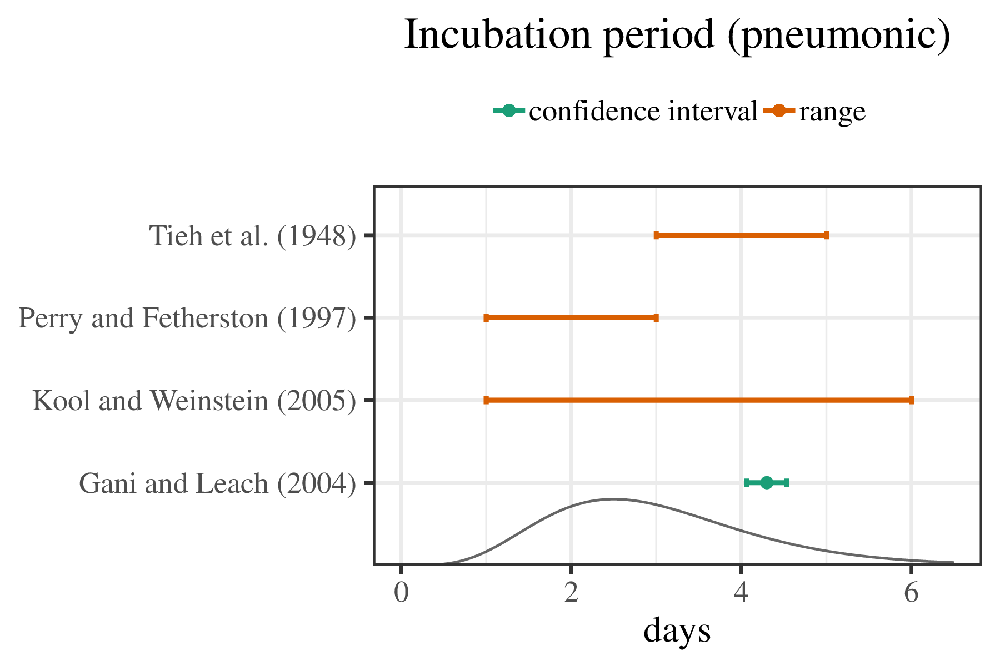

---
format:
  revealjs:
    embed-resources: true
    slide-number: true
---
<!-- revealjs-plugins: -->
<!--     - editable -->
<!-- filters: -->
<!--    - editable -->

## prior distribution

{.absolute width=912.7px height=600.4px left=0px top=89px}

## 

{.absolute width=1111.6px height=687px left=119.2px top=1.9px}

## tradeoff theory

{.absolute width=373px height=63px left=488.8px top=110.4px}
{.absolute width=526.6px height=133.9px left=457.1px top=-21.6px}
{.absolute width=454px height=476px left=577.8px top=190px}

## metapopulation patch occupancy

{.absolute width=958.8px height=668.3px left=0px top=56.7px}

